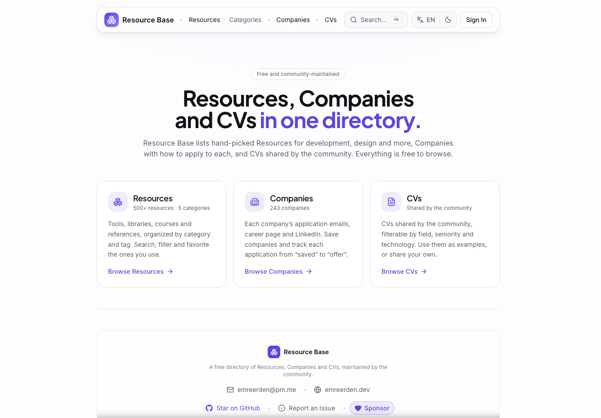

# Resource Base

A free, searchable **directory of companies** — with the emails, career pages and LinkedIn links you need to apply to each — plus a curated directory of the best resources for **development**, **design**, and anything else worth collecting. Save companies, track every application from "saved" to "offer" with private notes, browse ~500 hand-picked tools across a multi-level category and tag taxonomy, save favorites and suggest improvements. Built as a real, production application in **5 languages** with full control over design and data.



## Features

| Feature | Signed out | Signed in | How it works |
| --- | :---: | :---: | --- |
| **Company directory** | ✅ | ✅ | ~240 companies in a fresh random order on every visit (no ranking, by design); search and filter by city, work model, application channel and sector. Each company has a detail view and a shareable page with its application emails (one-click copy), career pages and LinkedIn. |
| **Application tracker** | — | ✅ | Bookmark companies and move each one through *saved → applied → interview → offer / rejected*, with private notes. Lives on its own page and on your profile — visible only to you. |
| **Import your tracker** | — | ✅ | Bring an existing list (e.g. a Notion export with “Şirket Adı” + “Durum”) into the tracker. The CSV is parsed in the browser — only matched companies and statuses are saved; unknown companies can be suggested in one click. |
| **Suggest a company** | — | ✅ | Propose a missing company with how to apply. It's reviewed in the Studio and, on approval, published automatically — and you're notified. Corrections to a listed company (links, emails, name — or "it's gone") work the same way. |
| **CVs** | ✅ | ✅ | Real CVs shared by the community, filterable by field, seniority, language and technology, with similar CVs suggested. Viewing one needs an account; sharing yours is reviewed first. |
| **Browse & filter** | ✅ | ✅ | Explore by category, tag, pricing and language; sort by featured, popularity, favorites, name or recency. |
| **Instant search** | ✅ | ✅ | A self-built ⌘K command palette with fuzzy matching across every resource, category and tag — no third-party search service. |
| **Resource details** | ✅ | ✅ | Each resource has a deep-linkable, shareable page with full description, taxonomy, related resources and rich SEO/OG metadata. |
| **Favorites** | — | ✅ | Save resources to your account and revisit them on a dedicated page. |
| **Submit a resource** | — | ✅ | Suggest a new resource; every submission is reviewed and, on approval, published automatically. |
| **Suggest edits** | — | ✅ | Propose better categories, tags or a clearer description for any resource — reviewed, then applied automatically on approval. |
| **Notifications** | — | ✅ | Get notified when your submission or suggestion is approved or needs changes. |
| **Your data** | — | ✅ | Export everything you've contributed as JSON, or permanently delete your account — self-service (GDPR / KVKK). |

> Content lives in a headless CMS, so resources are added, fixed and re-categorised without shipping code. A daily cron quietly checks every link and flags the broken ones for review.

## How it works

- **The homepage** introduces the directories. **Resources** live at `/resources` (old filtered links to `/` are permanently redirected there), **Companies** at `/companies` and **CVs** at `/cvs`. List pages are cached and rendered on the server; search, filters and the companies' random order run client-side, and filters stay in shareable URLs.
- **Browsing & search** are fully public and instant. Filters and the ⌘K palette run client-side over a tag-cached dataset, so navigating between categories, tags and resources feels immediate.
- **Signing in** (Google, GitHub, GitLab or email) unlocks the personal layer — the application tracker, favorites, submissions, suggestions and notifications — all scoped to your own account.
- **Submitting & suggesting** (resources, fixes and companies) never touch the live directory directly. Your contribution is stored as a moderated submission; an editor reviews it, and on approval the change is applied to the resource automatically and you're notified.
- **Content updates go live without a redeploy** — a CMS webhook revalidates just the affected pages on demand: an edited resource or company refreshes its own page and the lists showing it, not the whole site.

## Languages

The entire interface is available in **English, Turkish, Spanish, French and German**, switchable from the header. Your choice is remembered.

## Tech stack

- **Next.js (App Router) + React + TypeScript** — the application
- **Tailwind CSS + shadcn/ui + Radix** — design system and accessible primitives; **Magic UI** for the animated theme switch
- **Sanity** — headless CMS for resources, categories, tags, companies and submissions. The Studio is hosted by Sanity (`pnpm studio:deploy`), so it isn't part of the site's Worker; `/studio` redirects to it.
- **Better Auth** — authentication (Google/GitHub/GitLab OAuth + email/password with required email verification and password reset)
- **Cloudflare Turnstile** — bot protection on the account-creation and email-sending endpoints
- **Cloudflare D1 + Drizzle ORM** — user data (profiles, favorites, application tracker, submissions, notifications, CVs) and abuse counters
- **Cloudflare R2** — CV files and profile photos
- **cmdk + Fuse.js** — the self-built command palette and fuzzy search
- **Cloudflare Workers (via OpenNext)** — hosting; **KV** for the ISR page cache, a **Durable Object** queue for revalidation, **Email Sending** for password-reset mail, a separate **Cron Trigger** Worker for the broken-link checker, and **Web Analytics**

## Privacy & security

- **Your data is scoped to you.** Every read and write of user data (profile, favorites, submissions, notifications) goes through a server action / route handler that derives the user from the verified session and filters by their id, so one account can never read or modify another's data.
- **Secrets stay on the server.** Auth secret, database binding and CMS write tokens live only in server-only modules / Worker bindings and never reach the browser.
- **Hardened by default.** A strict Content-Security-Policy, HSTS, `X-Frame-Options`, `nosniff` and a safe-redirect auth callback ship in the production config. Webhooks are signature-verified and must be recent (replayed deliveries are refused); the link checker is a cron-only Worker with no public URL.
- **Email sign-up is verified and abuse-resistant.** New email/password accounts can sign in right away, but everything that saves or shares stays locked until the address is confirmed; an account left unverified for 7 days is suspended until it verifies — the sign-in dialog sends a new link, and opening it verifies the email, lifts the suspension and signs the user in. OAuth accounts arrive verified. The endpoints that create accounts or send mail are layered against spam / "denial of wallet": **Cloudflare Turnstile** blocks bots up front, **per-recipient** cooldown + hourly/daily caps stop mailbox bombing even across rotating IPs, Better Auth's **per-IP** rate limits sit on top, and a **global daily cap** is the final circuit breaker. When a limit is hit the user gets a clear message rather than a silent failure.
- **Abuse can't turn into cost.** Every dynamic request passes a per-IP limit before anything renders; writes have per-user limits; and site-wide **daily ceilings** cap new submissions, CV uploads, profile photos and emails however many accounts a spammer makes. All of this uses free Workers Rate Limiting bindings, the Cache API and D1 — never KV writes. Thresholds sit far above real usage. Emergency switches (`SIGNUPS_PAUSED`, `SUBMISSIONS_PAUSED`, `UPLOADS_PAUSED`) pause a feature, and `DAILY_CAP_*` variables raise a ceiling, from the dashboard without a deploy.
- **You're in control of your data.** Export a full JSON copy of everything you've contributed, or delete your account permanently — both self-service, no email required (GDPR Art. 17 & 20 / KVKK).
- **Analytics are privacy-respecting** and gated behind cookie consent.

## Local development

1. Copy the env template and fill in your values:
   ```bash
   cp .env.example .env.local
   ```
   Public/build variables go in `.env.local`; server secrets for the Worker go in `.dev.vars` (gitignored). See `.env.example` for the full, documented list:
   - `NEXT_PUBLIC_SANITY_PROJECT_ID`, `NEXT_PUBLIC_SANITY_DATASET`, `NEXT_PUBLIC_SITE_URL`
   - `SANITY_API_READ_TOKEN` (Viewer) and `SANITY_API_WRITE_TOKEN` (Editor)
   - `SANITY_REVALIDATE_SECRET`, `SANITY_NOTIFY_SECRET`
   - `BETTER_AUTH_SECRET`, `BETTER_AUTH_URL`, and the Google/GitHub/GitLab OAuth client id+secret pairs
   - `EMAIL_FROM` (verified sender), and optionally `NEXT_PUBLIC_TURNSTILE_SITE_KEY` + `TURNSTILE_SECRET_KEY` for bot protection

   > **Turnstile is optional locally** (Cloudflare's test keys are used) but **required in production**: without `TURNSTILE_SECRET_KEY`, email sign-up, sign-in and password reset are refused (OAuth still works). Set the site key as a build variable and the secret with `wrangler secret put`.
2. Install dependencies and run the dev server:
   ```bash
   pnpm install
   pnpm dev
   ```
3. Open `http://localhost:3000`. Run the Studio locally with `pnpm studio:dev` (http://localhost:3333). To test on the real Workers runtime, use `pnpm cf:preview`.

### Database

User-data schema lives in Drizzle (`lib/db/schema.ts`); migrations are generated into `drizzle/`. Apply them to Cloudflare D1:

```bash
pnpm db:generate           # generate SQL from the schema
pnpm db:migrate:local      # apply to the local D1
pnpm db:migrate:remote     # apply to the production D1
```

### Importing companies

Companies are managed in Sanity (Studio → *All companies*). The initial list was built from a Notion export; the raw export is **not** committed because it contains personal HR contacts and private application statuses. `companies:build` keeps only public, company-level data (generic inboxes, career pages, LinkedIn, location, sector) and writes `scripts/companies/data/companies.json`:

```bash
pnpm companies:build "/path/to/notion-export.csv"   # CSV → clean seed JSON
pnpm companies:import:dry                           # summarise, write nothing
pnpm companies:import                               # add missing companies (never overwrites Studio edits)
```

### Importing the legacy content

The original markdown lives in `_migration-source/`. This was a one-time import:

```bash
pnpm migrate:dry   # parse + summarise, write nothing
pnpm migrate       # import into Sanity
```

> **Don't run `pnpm migrate` against the live dataset again.** It doesn't duplicate documents, but it *replaces* them — wiping every Studio edit, link status and contributor credit made since.

## Deploying

Hosted on **Cloudflare Workers** (Paid plan) via OpenNext. Pushing to `main` triggers an automatic build + deploy through **Workers Builds** (build command `npx opennextjs-cloudflare build`, deploy command `npx opennextjs-cloudflare deploy`). Deploy only from there: a manual `pnpm cf:deploy` from a laptop bundles that machine's `.env.local` into the Worker.

Notes:
- Runtime secrets are set with `wrangler secret put`. The public `NEXT_PUBLIC_*` values and the Sanity **read** token are also **Build variables** in Workers Builds (Next.js inlines them / fetches Sanity at build time). The write token is a runtime secret only.
- Apply new D1 migrations to production with `pnpm db:migrate:remote` before (or right after) deploying a schema change.
- Add two Sanity webhooks (**sanity.io/manage → API → Webhooks**), drafts off, each with its secret:
  - **`/api/revalidate`** — trigger on create/update/delete, filter `_type in ["resource","category","tag","company"]`, projection
    `{ _type, "slug": slug.current, "skip": delta::changedOnly((lastCheckedAt, httpStatus, linkStatus, linkFailures)) && (before().linkStatus == "broken") == (after().linkStatus == "broken") }`
    so the link checker's daily bookkeeping doesn't re-render anything unless a link turns broken (or recovers).
  - **`/api/notify`** — trigger on create/update only, filter `_type == "submission" && status in ["approved","rejected"] && delta::changedAny(status)`, projection `{ _id, status, submittedBy, name, url, rejectionReason, kind, targetResourceId }`.
- Deploy the Studio with `pnpm studio:deploy` (and again after schema changes).
- The Sanity dataset is public (the free plan has no private datasets), so submissions carry no personal data: no emails, and the CV review link only opens for someone signed in on the site with an address in `ADMIN_EMAILS`.
- CVs and avatars are stored in the R2 bucket `resource-base-files` (binding `CV_BUCKET`). Create it once, near your users, with `npx wrangler r2 bucket create resource-base-files --location eeur` (R2 must be enabled on the account; the location can't be changed later). Uploaded CVs arrive in the Studio under **📄 Pending CVs**; approving or rejecting one there publishes it or notifies the owner through the same `/api/notify` webhook as other submissions.
- The broken-link checker runs daily as a separate Cron Trigger Worker (`workers/link-check-cron`); a link counts as broken after two failed checks in a row. It also deletes expired sessions, verification tokens, stale rate-limit rows and read notifications older than 180 days, and removes submissions decided more than 30 days ago from Sanity (the app keeps its own copy). Redeploy it (`cd workers/link-check-cron && pnpm run deploy`) after changing it.

### Production hardening

A few dashboard steps lock the site down further against bot abuse and spam:

1. **Turnstile (bot protection).** In the Cloudflare dashboard go to **Turnstile → Add widget**, add your domain (`resource-base.com`), and copy the two keys. Set `NEXT_PUBLIC_TURNSTILE_SITE_KEY` as a **Build variable** in Workers Builds (it's inlined into the client) and `TURNSTILE_SECRET_KEY` as a runtime secret (`wrangler secret put TURNSTILE_SECRET_KEY`). Once both are present, the auth forms render the widget and Better Auth rejects any sign-up / sign-in / verification / reset request without a valid challenge token. Without the secret those endpoints refuse every request.

2. **WAF rate limiting (network layer).** This stops floods *before* they reach the Worker, so they never cost you compute. It's a dashboard setting, not code. In the Cloudflare dashboard go to **Security → WAF → Rate limiting rules → Create rule** and guard the auth endpoints (the highest-value target):
   - **Field / match:** `URI Path` `contains` `/api/auth/`
   - **Rate:** `10` requests per `10 seconds` per client IP
   - **Action:** `Block` for `10 seconds`

   This is defense-in-depth on top of the in-app per-IP and per-recipient limits. The Free plan allows **one** rate-limiting rule, so spend it on `/api/auth/`. On a paid plan you can add a second, looser rule on all API routes (`URI Path contains /api/`, e.g. `100` requests per `10 seconds`, action `Managed Challenge`) — but it's optional: clicks, favorites, the tracker, profile edits and submissions are already rate-limited in-app (Workers Rate Limiting bindings, see `wrangler.jsonc`), and Cloudflare's automatic DDoS protection covers volumetric floods on every plan.

3. **Bot Fight Mode.** Turn it on under **Security → Bots** (free).

4. **Usage alerts.** Cloudflare has no spending cap, so set **Notifications → Usage-based billing** alerts for Workers, KV, D1 and Durable Objects to hear about an unusual month early.

5. **www → apex.** Add a **Rules → Redirect Rules** rule (`www.resource-base.com/*` → `https://resource-base.com/${1}`, 301). It runs before the Worker, so those requests cost nothing; the middleware redirect is only a fallback.

## Disclaimer

Resource Base is an independent directory. Listed resources are the property of their respective owners and are linked for discovery; inclusion does not imply any affiliation or endorsement. Company information is compiled from public sources, may be out of date, and does not mean a company is currently hiring — companies can request corrections or removal at any time.

## Feedback & contact

- **Want to add a resource or company, or fix a listing?** Do it on the site: [submit a resource](https://resource-base.com/submit/resource), [submit a company](https://resource-base.com/submit/company), or use the **Suggest** button on any resource or company page. You need a free account; every contribution is reviewed and published automatically on approval. Suggestions opened as GitHub issues aren't added.
- **Found a bug?** [Open an issue](../../issues/new/choose) — issues are for bugs and other project matters.
- **Anything else?** Email **emreerden@pm.me** or visit [emreerden.dev](https://emreerden.dev).

---

Created by [Emre Erden](https://emreerden.dev).
